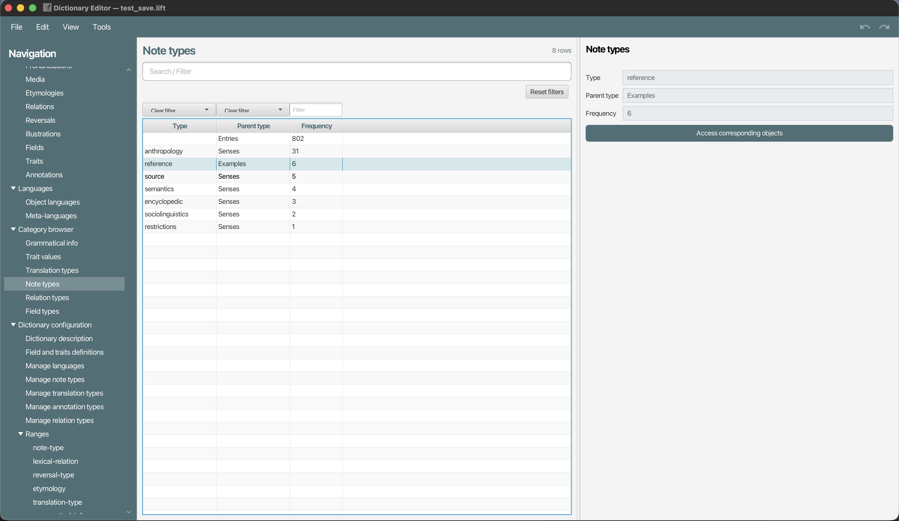
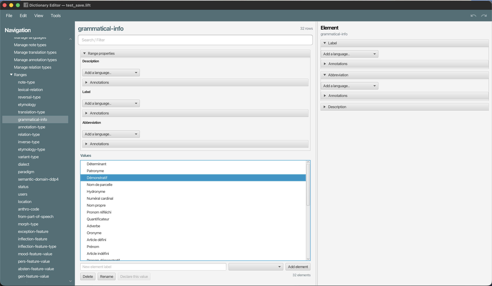

# Dictionary editor for descriptive linguistics

Application for editing dictionary compatible with the LIFT data format (This format is used by SIL Fieldworks and ELAN).

## Installation

Pick an installer for your plateform from the [github release page](https://github.com/sylvainloiseau/DictionaryEditor/releases).

## Usage

- DictionaryEditor profide a complete access to all the components of the LIFT data model: entries, sense, example, translation, illustration, trait, note, field, etc.
- It offers form for individual object and tables for each type of component, helping to increase comprehensiveness and consistency of the lexicographic description: missing field in a give language or field is visible.
- It offers browsers for categories of field, note, trait, annotation, and feature set

### Listing entries:


### Listing Senses


### Browse note type



### Managing part of speech



## Installation from sources

```bash
git clone "https://github.com/sylvainloiseau/DictionaryEditor.git"
cd DictionaryEditor
mvn install -DskipTests
```

Run :

```bash
mvn javafx:run
```

Tests :

```bash
mvn test
```

### Create a standalone app for all platforms (Windows, Linux, macOS)

The packaged standalone app will include a lighweight java runtime.

#### Dependencies

- JDK 21
- Maven 3.9+

#### Command line

On the repository root:

```bash
mvn clean package -Pdist -DskipTests \
  -Djavafx.platform=<plateforme> \
  -Djpackage.type=<type>
```

- Set the option `-Djavafx.platform` to the system on which you compile :

| target OS (build)   | Valeur de `-Djavafx.platform` |
|---------------------|-------------------------------|
| Linux x86_64        | `linux`                       |
| Windows x86_64      | `win`                         |
| macOS Apple Silicon | `mac-aarch64`                 |
| macOS Intel         | `mac`                         |

See the next sections for the values for `jpackage.type`.

##### Windows

**1/ With WiX installer**

**[WiX Toolset](https://wixtoolset.org/)** should be installed and in the `PATH`.

Files are in `target/jpackage/` (or `jpackage-msi` / `jpackage-exe` if you use suffixes as in the CI).

```bash
mvn clean package -Pdist -DskipTests \
  -Djavafx.platform=win \
  -Djpackage.type=MSI
```

**2/ Without WiX — app image** : the POM activates Windows options (`--win-menu`) incompatible with `app-image`. After a build that produced the jlink runtime (`target/maven-jlink/default/`), run **jpackage** once manually.

```bash
"%JAVA_HOME%\bin\jpackage.exe" ^
  --name DictionaryEditor ^
  --dest target\jpackage-app ^
  --type app-image ^
  --app-version 1.0.0 ^
  --runtime-image target\maven-jlink\default ^
  --vendor "CNRS LACITO" ^
  --module fr.cnrs.lacito.liftgui/fr.cnrs.lacito.liftgui.MainApp
```

Then run **`target\jpackage-app\DictionaryEditor\DictionaryEditor.exe`**.

If `mvn package … -Pdist` fails only on **jpackage** (WiX missing) but the **`target/maven-jlink/default`** folder has been created, the `jpackage` command above is sufficient to obtain the portable image. Otherwise, install **WiX** and use `-Djpackage.type=MSI` or `EXE`.

### Linux

Create deb package (default `jpackage.type` value)

```bash
mvn clean package -Pdist -DskipTests \
  -Djavafx.platform=linux \
  -Djpackage.type=DEB
```

On Debian/Ubuntu, `fakeroot` tools may be needed; the CI also installs `rpm` for some steps. The `.deb` is generated under `target/jpackage/`. Installation :

```bash
sudo dpkg -i target/jpackage/*.deb
```

Then run the application from the applications menu or the command installed by the package.

### macOS

Create a disk imaege (`.dmg`) (select the correct value for `javafx.platform` : `mac-aarch64` or `mac`, see above) :

```bash
mvn clean package -Pdist -DskipTests \
  -Djavafx.platform=mac-aarch64 \
  -Djpackage.type=DMG
```

On Mac M1, try `-Djavafx.platform=mac` if your JDK/OpenJFX provides it. The `.dmg` is generated under `target/jpackage/`. Open the DMG and drag the application into **Applications**, then run it from the Launchpad or the Applications folder.

### Releases GitHub

A GitHub workflow (`.github/workflows/release.yml`) automatically builds the installers for **Linux**, **Windows** and **macOS** when a **tag** is pushed, for example :

```bash
git tag v1.0.0
git push origin v1.0.0
```

The artifacts are attached to the corresponding **Release** on GitHub (`.deb`, `.msi`, `.exe`, `.dmg` files according to the successful jobs).

## Icon

The application icon is plate 16 of:

> Le Vaillant, François. *Histoire naturelle des oiseaux de paradis et des rolliers, suivie de celle des toucans et des barbus*. Vol. 1. Paris: Denné le jeune, Perlet, 1806. Plate 16: « Le Nébuleux, étalant ses parures » (the "Nébuleux" bird-of-paradise displaying its plumes), painted by Jacques Barraband, engraved by Pérée, printed by Langlois. DOI: [10.5962/bhl.title.61652](https://doi.org/10.5962/bhl.title.61652).

The scan is from the Smithsonian Libraries copy, digitised by the [Biodiversity Heritage Library](https://www.biodiversitylibrary.org/page/40634990). The file used is [Histoire naturelle des oiseaux de paradis et des rolliers (No. 16) (8112364012).jpg](https://commons.wikimedia.org/wiki/File:Histoire_naturelle_des_oiseaux_de_paradis_et_des_rolliers_(No._16)_(8112364012).jpg) on Wikimedia Commons. The illustration is in the public domain. For the icon, the plate was cropped to the bird, its paper whitened (the uneven lighting evened out, a fold line removed), and white margins added to make it square.

## Authors

- Sylvain Loiseau, Sorbonne Paris Nord University / Lacito-CNRS laboratory
- Computer science students, Sorbonne Paris Nord University:
  - Inès GBADAMASSI
  - Maryse GOEH-AKUE
  - Ermeline BRESSON
  - Ayman JARI
  - Erij MAZOUZ
